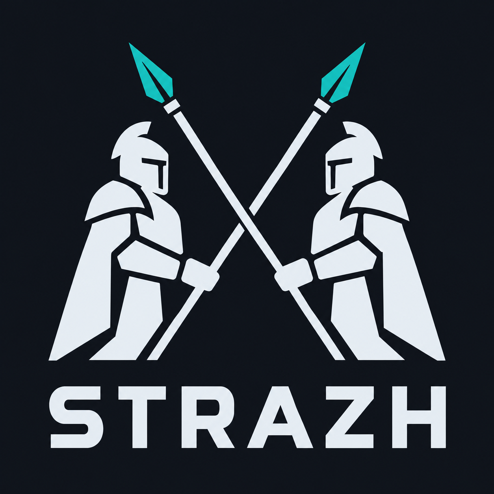
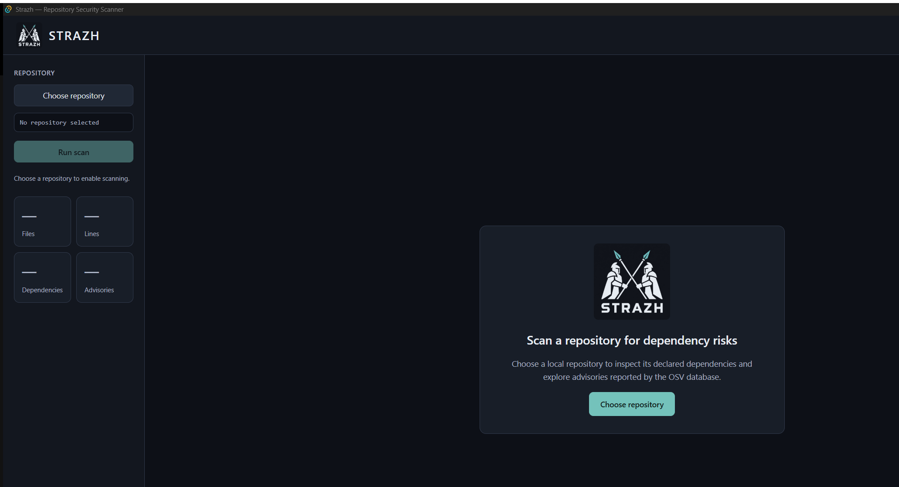

# Strazh — Repository Security Scanner

**License: [MIT](./LICENSE)**

Strazh is a desktop app (Tauri + React + Rust) that inspects a **local
repository's declared dependencies** for known vulnerabilities and helps you
understand and remediate them. It:

- scans a local repository and reads the dependencies **declared in its
  manifests** (e.g. `Cargo.toml`, `package.json`, `requirements.txt`,
  `pyproject.toml`);
- matches each declared package + version against the **[OSV](https://osv.dev)**
  advisory database;
- shows, for a selected finding, the **manifest → package → advisory**
  relationship and, when the advisory provides one, an **advisory-reported
  fixed version**;
- generates **advisory-based remediation guidance** with an **NVIDIA Nemotron**
  model served through **[Nebius Token Factory](https://nebius.com)**;
- can optionally **apply a local version bump** to the declaring manifest when
  the advisory provides a fixed version (with a one-click **Undo**).

> **Scope of the analysis.** A finding means a declared dependency matches an
> OSV advisory for the scanned version. This is a **declaration-based
> relationship** — it shows that the vulnerable package is declared/available,
> **not** that the vulnerable code is reached at runtime or is exploitable in
> your application. Strazh does not perform reachability or exploitability
> analysis.

The AI guidance is **not** a verified or tested fix: "advisory-reported fix"
versions come from OSV, not from Strazh verifying your project. Strazh never
changes your repository on its own — **scanning and generating guidance write
nothing to disk**. The only change Strazh can make is the explicit, local
**Apply fix** action you trigger per finding, which edits one dependency
version in a manifest on your machine (and can be undone). Nothing is ever sent
to a remote host or opened as a pull request.

## Demo video

[Watch the 3-minute demo on YouTube](https://www.youtube.com/watch?v=CFnPRriDur4)

The recording scans
[`github.com/nebius/token-factory-cookbook`](https://github.com/nebius/token-factory-cookbook)
end to end: pick the repo → run the scan (547 declared dependencies, 1,078 OSV
findings, 31 Critical) → select the Critical `agno@1.5.1` Eval Injection
advisory → generate Nemotron remediation grounded in the advisory → click
**Apply fix** to pin `agno` to the advisory's fixed version `2.3.24` in
`pyproject.toml`, with an **Undo**.

## How it works

Strazh runs the full find → understand → suggest → apply loop locally:

1. **Parse manifests.** It walks the selected repository and reads the
   dependencies declared in its manifests (`Cargo.toml`, `package.json`,
   `requirements.txt`, `pyproject.toml`, `go.mod`), de-duplicating to the unique
   `(name, version, ecosystem)` tuples it can resolve to a concrete version.
2. **Query OSV live.** For each resolvable dependency it queries the
   **[OSV](https://osv.dev)** API (`https://api.osv.dev/v1/query`) for known
   advisories matching that package and version, and extracts the advisory
   severity and — when provided — the advisory-reported fixed version
   (ecosystem-aware version comparison, never lexical).
3. **Build the attack-path relationship.** For a selected finding it shows the
   **manifest → package → advisory** relationship: which file declares the
   vulnerable dependency, the package itself, and the OSV advisory it matched.
   This is a declaration-based relationship, not a runtime-reachability proof.
4. **Ground remediation with Nemotron.** On demand it asks an **NVIDIA
   Nemotron** model on **[Nebius Token Factory](https://nebius.com)** for
   remediation guidance, passing only advisory metadata (see
   [How Nemotron & Nebius Token Factory are used](#how-nemotron--nebius-token-factory-are-used)).
5. **Apply locally, with Undo.** When the advisory has a fixed version, you can
   apply a single, local version bump to the declaring manifest and revert it
   with one click. Nothing is pushed, committed, or opened as a PR.

## How Nemotron & Nebius Token Factory are used

Strazh uses an **NVIDIA Nemotron** model served through **Nebius Token
Factory** for the remediation-guidance step only. Specifics, from
`src-tauri/src/nebius_client.rs`:

- **Model.** Default `nvidia/Nemotron-3_5-Lightning`, overridable with the
  `NEBIUS_MODEL` environment variable (or the local `.env`).
- **Endpoint.** The OpenAI-compatible Token Factory endpoint
  `https://api.tokenfactory.nebius.com/v1`, overridable with `NEBIUS_BASE_URL`.
- **Credential.** The `NEBIUS_API_KEY` is read only from the environment or the
  per-user config file (see [Configuring the Nebius credential](#configuring-the-nebius-credential));
  it is never bundled, logged, or printed.
- **When it runs.** Only when you explicitly click **Generate** for a selected
  finding. Scanning never contacts Nebius.
- **What it receives — advisory metadata only.** The request contains the
  advisory id and summary, the declared component (`name@version`), the
  ecosystem, the declaring manifest path, and the advisory-reported fixed
  version when present. **Dependency source code is never fetched or sent**; the
  prompt explicitly tells the model source is unavailable, so the output is
  advisory-grounded guidance rather than a source-level patch.

## Screenshots

Captured from the running release build. The personal repository path shown in
the sidebar has been redacted to `demo-cookbook`; findings and generated output
are unaltered.

**Welcome / repository selection**



**Completed scan with severity summary and a selected finding**


**Generated AI remediation guidance, with the local Apply fix**


The [demo video](#demo-video) shows the same repository
([`github.com/nebius/token-factory-cookbook`](https://github.com/nebius/token-factory-cookbook))
reporting **547 declared dependencies** and **1,078 OSV findings** (including
**31 Critical**), with the Critical `agno@1.5.1` finding
(**GHSA-77rh-m34w-rv36**, Eval Injection) selected and **Apply fix** pinning it
to the advisory's fixed version **2.3.24** in `pyproject.toml`, with an
**Undo**.

> **Why the screenshots and the demo video report different totals.** Both are
> real, unaltered runs against the same repository. The declared-dependency
> count (547) is identical; the advisory/finding totals differ because **OSV is
> a live database that keeps adding advisory records over time** — the
> screenshots were captured earlier (913 advisories, 15 Critical, with the
> `agno` finding resolving to `agno@1.7.2`) and the demo video is a later run
> (1,078 findings, 31 Critical, `agno@1.5.1`). The vulnerability
> (GHSA-77rh-m34w-rv36, Eval Injection) and the advisory-reported fix (2.3.24)
> are the same in both.

> Note: the `ai-remediation.png` capture above shows the guidance panel before
> the Apply fix / Undo controls were added. The Apply-fix behavior it now
> includes is described under [Usage → Apply fix](#apply-fix-local-manifest-edit).

## Quick start (Windows)

### Install and launch

1. Build the installer locally (see [Development](#development)) or use an
   existing artifact from `src-tauri/target/release/bundle/` (see
   [Release](#release)).
2. Run the NSIS setup (`Strazh_<version>_x64-setup.exe`) or the MSI
   (`Strazh_<version>_x64_en-US.msi`) and follow the prompts, or run the
   portable executable `cyclonedx-tauri-ui.exe` directly.
3. Launch **Strazh — Repository Security Scanner** from the Start menu (or the
   executable).

**WebView2 runtime.** The UI renders in Microsoft Edge WebView2, which is
preinstalled on current Windows 10/11. The bundle does not pin a custom
WebView2 install mode, so Tauri's default behavior applies: if the runtime is
missing, the NSIS installer offers to download and install it. No bundled
offline WebView2 installer is included.

### What needs network or a key

- **Repository scanning works without a Nebius key.** However, matching
  dependencies against OSV requires **network access** to `https://api.osv.dev`.
- **AI remediation guidance requires a Nebius credential and network access**
  to Nebius Token Factory.

### Configuring the Nebius credential

Strazh reads the key `NEBIUS_API_KEY` at **startup**, in this exact order (from
`src-tauri/src/lib.rs`, `load_local_env`):

1. **Process environment** — if `NEBIUS_API_KEY` is already set in the
   environment, that value is used and nothing below overrides it.
2. **Development only** — in development builds (`cargo`/`npm run tauri dev`,
   i.e. `debug_assertions` on), a `.env` in the current working directory is
   loaded. This does **not** apply to the packaged app.
3. **Per-user config file (all builds)** — exactly one file:

   ```
   %APPDATA%\com.strazh.app\.env
   ```

   containing:

   ```
   NEBIUS_API_KEY=your_key_here
   ```

This file **stores the credential locally on disk** in your user profile. It is
**outside the installer** and is never bundled into the app. There is **no**
directory-walking or repository `.env` discovery — only the locations above are
consulted. After creating or changing this file, **restart the app**; a running
instance does not pick up configuration changes.

> Development configuration note: the repository ships
> `src-tauri/.env.example`. For local development you may copy it to
> `src-tauri/.env` and run from `src-tauri/` (step 2 above). The packaged app
> does **not** read `src-tauri/.env` — use the `%APPDATA%\com.strazh.app\.env`
> location instead.

Optional overrides (environment variable or the same `.env`):

- `NEBIUS_MODEL` — Nemotron model id (default `nvidia/Nemotron-3_5-Lightning`).
- `NEBIUS_BASE_URL` — Token Factory base URL (default
  `https://api.tokenfactory.nebius.com/v1`).

## Usage

1. **Choose repository** — pick a local folder.
2. **Run scan** — Strazh reads declared dependencies and queries OSV. Files,
   lines, and dependency counts populate as the scan progresses; the advisory
   count appears when the OSV lookup completes.
3. **Filter findings** — search by package or advisory id, and filter by
   severity. A severity summary (Critical / High / Medium / Low / Unknown) is
   shown above the list.
4. **Select an advisory** — the detail pane shows the package, advisory id,
   severity, and the advisory summary when provided.
5. **Inspect the declaring manifest** — the relationship graph shows
   **manifest → package → advisory**. The manifest is the file that declares
   the dependency (evidence from the scan). This indicates declaration, not
   runtime reachability.
6. **Generate guidance** — request AI remediation for the selected finding.
7. **Apply fix (optional, local)** — when the advisory provides a fixed version,
   an **Apply fix → `<version>`** button appears under the guidance. Clicking it
   rewrites that one dependency's version in the declaring manifest on disk and
   shows a confirmation such as
   `Updated pyproject.toml: agno >=1.5.1 → 2.3.24`, with an **Undo** that
   restores the original file content.

### Apply fix (local manifest edit)

The Apply fix action is deliberately conservative and local-only (it uses
Tauri's file APIs — no network, no git, no pull request):

- **What it rewrites.** A single dependency's version in the manifest that
  declared it, set to the advisory's fixed version. It handles both pinned
  versions and simple ranges, dropping the range operator:
  - `requirements.txt` / `pyproject.toml`: `agno>=1.5.1`, `agno~=1.5`, or bare
    `agno` → `agno==2.3.24`
  - `package.json`: `"^1.7.2"` / `"~1.7.2"` → `"2.3.24"`
  - `Cargo.toml`: `"^1.7"` → `"2.3.24"`
  - `go.mod`: `pkg vX.Y.Z` → the fixed version
- **What it refuses.** If the package appears more than once, uses a
  workspace/complex form, or no fixed version is available, Strazh does **not**
  edit the file and shows a clear message (e.g. *"Could not safely update this
  package's version… it appears more than once, uses a complex/workspace form,
  or no fixed version was provided. Edit it manually."*).
- **Undo.** Strazh keeps the original file content in memory for the current
  session and restores it exactly when you click **Undo**.
- **Scope.** It only writes within the scanned repository folder, and only the
  one version token changes — the rest of the manifest (formatting, other
  entries) is preserved.

Notes on interpreting results:

- **Severity "Unknown"** means OSV did not provide a severity Strazh could
  classify (for example, only a CVSS vector string with no numeric score). It
  does not mean "safe."
- **Advisory-reported fix version** is taken from the OSV advisory for the
  scanned version. It indicates an available upgrade target, **not** proof that
  your project is secure. When applicability cannot be determined, the UI shows
  **"Fix version not determined."** Always review version compatibility and
  test upgrades before relying on them.
- **Advisory counts** reflect advisory records, not proven exploitable paths.
  The same advisory can appear more than once when a package is declared at
  different versions or in different manifests; Strazh de-duplicates only the
  identical `(name, version, ecosystem)` tuple before querying OSV.

## Development

Prerequisites:

- Node.js 18+ and npm
- Rust (stable) and the
  [Tauri v2 prerequisites](https://tauri.app/start/prerequisites/) (on Windows:
  the MSVC toolchain and WebView2)

Commands (verified against `package.json` and `src-tauri/Cargo.toml`):

```bash
# Install frontend dependencies
npm install

# Run the app in development (frontend + Rust backend, hot reload)
npm run tauri dev

# Frontend production build + TypeScript typecheck
npm run build        # runs: tsc && vite build

# Frontend behavior tests (Vitest + Testing Library + jsdom)
npm run test         # runs: vitest run

# Backend compile check
cargo check --lib --manifest-path src-tauri/Cargo.toml

# Build the Windows release + installers (MSI and NSIS)
npm run tauri build
```

### Architecture

- **Frontend (`src/`)** — a single-screen React 19 UI. `src/StrazhApp.tsx`
  drives the flow; `src/Markdown.tsx` is a small, dependency-free Markdown
  renderer used for AI output (no raw HTML / no `dangerouslySetInnerHTML`, with
  a copy-to-clipboard control for code blocks).
- **Shell (`src-tauri/`)** — Tauri v2 wraps the web UI in a native window and
  exposes Rust commands over the Tauri bridge.
- **Scanning (Rust)** — `src-tauri/src/supply_chain.rs` walks the repository and
  parses declared dependencies from manifests; `src-tauri/src/commands.rs`
  (`scan_code_graph`, `scan_with_osv`) runs the scan.
- **OSV (Rust)** — `src-tauri/src/osv_client.rs` queries the OSV API and
  extracts advisory severity and the applicable fixed version (ecosystem-aware
  version comparison; never lexical).
- **AI (Rust)** — `src-tauri/src/nebius_client.rs` calls an NVIDIA Nemotron
  model (default `nvidia/Nemotron-3_5-Lightning`) on the Nebius Token Factory
  OpenAI-compatible endpoint; `generate_nemotron_fix` in `commands.rs` builds
  the request from advisory evidence.

### Tests and a known limitation

- **Frontend:** `npm run test` runs Vitest suites in `src/*.test.tsx` covering
  AI-response isolation across finding selection and rescans, duplicate-submit
  prevention, exact clipboard copy, and the fixed-version / "not determined"
  display.
- **Backend:** the Rust regression suite for OSV fixed-version matching and the
  credential-loader scoping is run via a standalone binary:

  ```bash
  cargo run --bin osv_tests --manifest-path src-tauri/Cargo.toml
  ```

  This harness exists because `cargo test --lib` does not start on this
  Tauri/Windows library crate (the test executable fails to load with
  `STATUS_ENTRYPOINT_NOT_FOUND`). The same assertions also exist as
  `#[cfg(test)]` modules for environments where the standard harness works.

- **Connectivity check:** `cargo run --bin nebius_test --manifest-path src-tauri/Cargo.toml`
  sends one request to confirm the Nebius credential and model are reachable
  (requires `NEBIUS_API_KEY`). It never prints the key.

## Data handling and limitations

Based on the current code:

- **Stays local:** the repository contents, the parsed manifest/dependency
  list, scan metrics, and your selection. Strazh does not upload repository
  source code.
- **Sent to OSV (`https://api.osv.dev/v1/query`):** for each declared
  dependency with a concrete version, the **package name, ecosystem, and
  version** are sent to look up advisories.
- **Sent to Nebius (only when you click Generate):** the **advisory id and
  summary, the declared component (`name@version`), the ecosystem, the
  declaring manifest path, and the advisory-reported fixed version** (when
  present). Dependency **source code is not fetched or sent** — the remediation
  prompt explicitly states source is unavailable, so guidance is advisory-based
  rather than a source-level patch.
- **Repository files are only modified by the explicit Apply fix action.**
  Scanning and generating guidance never write to your project. The optional
  **Apply fix** button (which you click per finding) rewrites exactly one
  dependency version in the declaring manifest, locally; **Undo** restores it.
  There is no automatic patching and no remote/VCS action.

Analysis limitations:

- Findings are **declaration-based**; Strazh does not prove runtime reachability
  or exploitability.
- Dependencies without a concrete, resolvable version are **not queried**
  (Strazh does not guess a version).
- Severity may be **Unknown** when OSV does not provide a classifiable severity.
- The AI remediation is **AI-generated guidance, not a tested repository
  patch**; review and test before applying anything.

This section describes current behavior and is not a privacy guarantee.

## Release

**Latest release: [v0.1.0 (Windows)](https://github.com/rustoman-AI/strazh-code/releases/tag/v0.1.0)**

Download the Windows installer from the release page:

| Artifact | Download | SHA-256 |
|---|---|---|
| MSI | [`Strazh_0.1.0_x64_en-US.msi`](https://github.com/rustoman-AI/strazh-code/releases/download/v0.1.0/Strazh_0.1.0_x64_en-US.msi) | `2BFA8B297439FC4C411FA4AB798E707B3AEAC98123691FF166A10E1C0414CB84` |
| NSIS setup | [`Strazh_0.1.0_x64-setup.exe`](https://github.com/rustoman-AI/strazh-code/releases/download/v0.1.0/Strazh_0.1.0_x64-setup.exe) | `0A36F5F6209F6031159F715688B38FB627D36F977AB7291109E6A60FBC590319` |

Verify a download before running it:

```powershell
Get-FileHash .\Strazh_0.1.0_x64_en-US.msi -Algorithm SHA256
```

### Building locally instead

```bash
npm run tauri build
```

The artifacts are written to:

```
src-tauri/target/release/bundle/msi/Strazh_0.1.0_x64_en-US.msi
src-tauri/target/release/bundle/nsis/Strazh_0.1.0_x64-setup.exe
src-tauri/target/release/cyclonedx-tauri-ui.exe
```

A local build's hashes will differ from the published ones above (Tauri bundles
are not byte-for-byte reproducible); recompute from your own build if needed.

The installers and executable contain no API keys or `.env` contents; the
credential lives only in your per-user config file described above.

## License

[MIT](./LICENSE)
